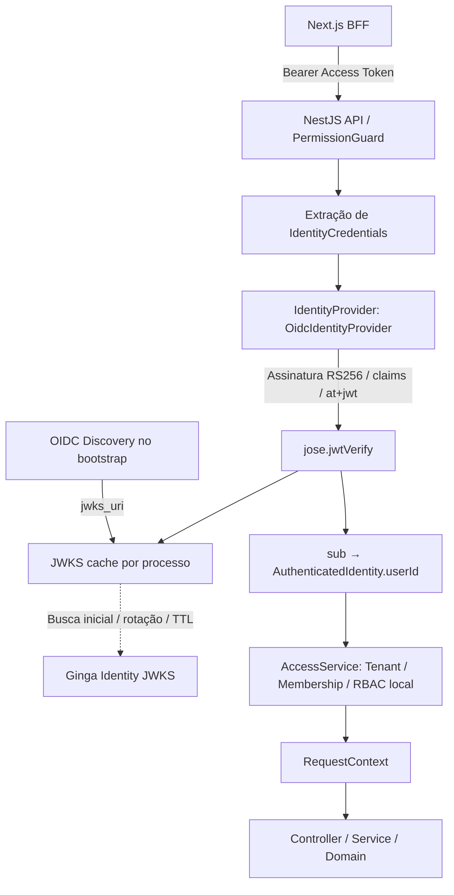

# Arquitetura de autenticação

O guard já existente extrai credenciais e depende exclusivamente de
`IdentityProvider`. Uma factory assíncrona Nest seleciona Fake/OIDC pelo
ConfigService validado. Discovery termina antes de o Nest atender requests.
O provider somente autentica. A resolução de tenant, roles e permissions continua
no AccessService e nas transações existentes. O RequestContext mantém a identidade
e a autorização local imutáveis, sem propagar claims arbitrários do JWT.
