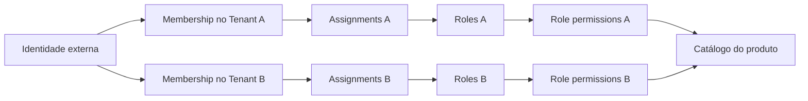

# Authorization/RBAC e isolamento de tenants

## Responsabilidades e composição

Authentication comprova **quem** chamou; authorization decide **o que** pode fazer;
tenancy valida **em qual tenant**; RLS limita **quais linhas** a conexão acessa.
O Identity Provider é externo. Não há senhas, JWT local, cadastro de credenciais ou
confiança em `request.user`, headers de usuário ou permissões enviadas pelo cliente.

`AUTHORIZATION_MODE=single` compõe roles, permissions, referências de identidade e
assignments. `AUTHORIZATION_MODE=tenant` compõe tenants, memberships, roles por
tenant e RLS. O núcleo de avaliação e o service de gerenciamento são os mesmos.
Os schemas são alternativas de geração: **não troque o modo de um banco com dados**.
O bootstrap verifica a compatibilidade entre modo e schema.

| Responsabilidade               | Implementação                                   |
| ------------------------------ | ----------------------------------------------- |
| Catálogo, avaliação e contexto | `shared/module/authorization`                   |
| Integração de identidade       | porta transport-agnostic `IdentityProvider`     |
| Gerenciamento e invariantes    | `access-control/core/service/AccessService`     |
| Persistência e atomicidade     | porta `AccessStore`, adapter `AccessRepository` |
| Transação e contexto SQL       | `shared/module/tenant-database`                 |
| Tenant desejado                | `TenantResolver`, substituível                  |

O pacote `access-control` possui as tabelas relacionadas e um DataSource nomeado
`access-control`. Isso evita transações distribuídas no bootstrap. Services não
importam TypeORM nem erros HTTP; controllers não conhecem repositories.
O exemplo global `/examples` só é composto no modo simples. Um produto multitenant
deve adaptar suas entidades com o padrão descrito abaixo antes de expor endpoints.

## Integração com o Identity Provider

`IdentityProvider` recebe somente `IdentityCredentials` e retorna
`AuthenticatedIdentity | null`. O adaptador HTTP extrai um único Bearer token,
mas não entrega `Request`, JWT ou detalhes de OIDC aos providers, services ou
controllers. A identidade principal é sempre `userId`.

Em desenvolvimento e testes, `IDENTITY_PROVIDER=fake` compõe
`FakeIdentityProvider`:

| Bearer token          | `identity.userId`   |
| --------------------- | ------------------- |
| `fake-token-user-a`   | `usr_fake_a`        |
| `fake-token-user-b`   | `usr_fake_b`        |
| `fake-token-admin`    | `usr_fake_admin`    |
| `fake-token-stranger` | `usr_fake_stranger` |

O mapa é fechado: um token como `Bearer usr_attacker` não cria a identidade
`usr_attacker`. O fake não retorna claims, roles, permissions, membership ou tenant.
Ele é recusado quando `NODE_ENV=production`.

`IDENTITY_PROVIDER=oidc` seleciona o ponto de composição OIDC e falha no bootstrap
até que o adapter Ginga Identity seja instalado. Isso evita publicar uma API que
parece validar tokens sem fazê-lo. A troca não altera guards, controllers, serviços,
tenancy ou RBAC:

```ts
AccessControlModule.forRoot("tenant", {
  identity: GingaOidcIdentityProvider,
  imports: [GingaIdentityIntegrationModule],
});
```

O adapter implementa `IdentityProvider.authenticate(credentials)` e retorna
`{ userId: string } | null`. Ele deve validar assinatura JWKS, issuer, audience,
expiração e validade do token antes de retornar `claims.sub` como `userId`.
`userId` é um identificador externo
opaco e estável, não um email. Se houver múltiplos issuers, a integração deve produzir
identificadores sem colisão entre issuers. O pacote não escolhe SDK, endpoints ou
claims do IdP porque o contrato externo ainda não existe neste repositório.
`IDENTITY_PROVIDER` somente escolhe a implementação padrão. Um produto pode injetar
um adapter próprio pelo campo `identity` de `forRoot` enquanto a integração OIDC é
desenvolvida. Nenhum desses adapters deve receber ou interpretar roles/permissions.

## Permissions em código

```ts
export const Permission = definePermissions({
  role: ["read", "create", "update", "delete", "assign"],
  member: ["read", "invite", "update", "remove"],
  example: ["read", "create"],
});

Permission.role.create; // literal "role:create"
```

`Permission` também é o tipo união dos identificadores. O catálogo é congelado;
`isPermission` verifica entradas externas. Um grant desconhecido no banco também
é descartado ao carregar contexto. O runtime só tem SELECT em `access_permission`.
Tenants podem combinar permissions existentes, nunca criar novos identificadores.

Para adicionar `project:update`, edite o catálogo do produto, acrescente uma
**nova migration de dados** que insira esse identificador, defina quais system roles
o recebem e proteja os endpoints. A migration inicial usa um snapshot congelado:
não importe o catálogo vivo em migrations antigas. Remoções exigem remover os grants
relacionados antes da linha de permission. Alterações no catálogo não concedem
automaticamente novos poderes a roles já persistidas; a concessão precisa de uma
migration de dados explícita e revisão de segurança.

## Roles, memberships e ownership

No modo simples, `access_identity_user` guarda somente UUID local, identificador
externo e timestamps. `access_role_assignment` relaciona esse UUID a várias roles.
No modo tenant, o identificador externo fica em `access_membership`, com
`UNIQUE(tenantId, identityUserId)`. Não existe role global do usuário nessa modalidade.



Roles têm UUID, nome, slug, descrição, `isSystem`, timestamps e, no modo tenant,
`tenantId NOT NULL`. Slugs são únicos no tenant. FKs compostas entre assignments,
roles, memberships e grants impedem relações cross-tenant mesmo com IDs conhecidos.
Os índices compostos começam por tenantId. Membership suporta várias roles; as
permissions efetivas são a união, sem DENY explícito e sem wildcard.

`SYSTEM_ROLES` define OWNER, ADMIN e MEMBER. Cada bootstrap cria novas linhas
dessas roles dentro do tenant. OWNER e ADMIN recebem o catálogo inicial explícito;
MEMBER recebe somente `example:read`. Produtos devem revisar esses defaults.
`member:update` é reservado a futuros casos de uso; não existe endpoint genérico
para editar memberships, nem status artificial nesta versão.

Para adicionar uma system role, edite `SYSTEM_ROLES` e crie migration/provisionamento
explícito para tenants existentes. Não altere migrations já aplicadas.

As system roles não podem ser editadas/deletadas pela API. Um trigger também impede
alteração/deleção da linha e promoção de custom role para system role. Slugs
`owner`, `admin` e `member` são reservados. As permissions das system roles só são
definidas pelo bootstrap/migrations, sem API de edição.

Somente um OWNER pode conceder ou retirar OWNER. O último OWNER não pode perder sua
role nem ser removido. Para transferir ownership, atribua OWNER ao destinatário e
depois remova do anterior. Não há `ownerId` redundante no Tenant. Locks transacionais
protegem o cálculo de último OWNER; um constraint trigger diferido também rejeita
commit sem OWNER, inclusive bootstrap incompleto. Não há API de exclusão de tenant.

O `deletedAt` da entidade base existente ainda tem um TODO de soft delete. As novas
entidades não o herdam: remoção de custom roles/memberships é física, com cascatas
restritas aos relacionamentos e auditoria preservada. Não há reativação implícita.

## Proteção de endpoints e políticas de domínio

```ts
@RequirePermission(Permission.role.create)
@Post("roles")
create(@Body() input: RoleDto) {
  return this.access.createRole(input);
}

@RequireAllPermissions(Permission.example.read, Permission.example.create)
@Get("all")
all() { /* ambas são obrigatórias */ }

@RequireAnyPermission(Permission.example.read, Permission.example.create)
@Get("any")
any() { /* pelo menos uma é obrigatória */ }
```

O guard é global. Ausência de metadata, requisitos vazios, identities ausentes ou
permission desconhecida negam acesso. Regras na classe e no método são combinadas
com AND; o método não enfraquece a classe. Use um decorator de permissions por alvo;
use ALL/ANY para combinar várias permissions. Não existe decorator público de bypass.
A única exceção interna é o signup explícito de tenant, que exige identidade validada.

O `AuthorizationService` centraliza `can`, `hasPermission`, `hasAnyPermission`,
`hasAllPermissions` e `require`. O guard não reimplementa avaliação. Os serviços de
gerenciamento também verificam suas permissions, inclusive quando chamados fora de HTTP.

RBAC não substitui regras do domínio. Um service de projeto verifica
`authorization.require(context, Permission.project.update)` e depois uma política
como `projectPolicy.assertDraft(project)` na operação que altera o projeto.
Não existe framework ABAC nesta versão. Use lock/controle de versão da entidade
quando a regra depender do estado concorrente do domínio.

## Tenant desejado e RequestContext

O resolver padrão aceita um único `x-tenant-id` UUID. Headers duplicados, listas,
valores inválidos e contexto ausente são rejeitados. Ele somente determina o tenant
desejado; o service confirma tenant e membership consultando o banco sob RLS.
Tenant inexistente e usuário sem membership retornam o mesmo 403.

Substitua o resolver via `forRoot(mode, { tenantResolver: SeuResolver })` para usar
subdomínio, route ou claim validada. Se a rota também trouxer tenantId, seu resolver
deve conferir a correspondência: não aceite dois tenants contraditórios. Controllers
de gerenciamento nunca recebem tenantId no payload. No modo simples, um header de
tenant é rejeitado. Signup não aceita header de tenant existente.

Depois da validação, `RequestContexts.current()` fornece uma cópia congelada de:

```ts
{
  identity: { userId },
  tenant: { id: tenantId, membershipId }, // ausente no modo simples
  authorization: { roleIds, permissions }
}
```

O armazenamento é AsyncLocalStorage, sem singleton mutável por request. A ligação
entre guard e interceptor usa WeakMap interno, sem confiar em propriedades anexadas
ao request por clientes. O guard faz uma leitura inicial; o interceptor abre a
transação, obtém o lock, recarrega membership/permissions e reavalia as regras antes
do handler. A transação só confirma quando o handler termina com sucesso.

Essa revalidação resolve TOCTOU: uma revogação confirmada antes da obtenção do lock
nega a operação pendente. Uma operação que já obteve o lock termina antes da revogação.
Os casos de uso revalidam também suas permissions, protegendo chamadas internas e
operações encadeadas. Não há cache de permissions nem janela de invalidação.

## APIs de gerenciamento

| Endpoint                                         | Permission / regra                                       |
| ------------------------------------------------ | -------------------------------------------------------- |
| `POST /tenants`                                  | identidade autenticada; somente composição tenant        |
| `GET /access/roles`                              | `role:read`                                              |
| `POST /access/roles`                             | `role:create`                                            |
| `PUT /access/roles/:id`                          | `role:update`; substitui dados e conjunto de permissions |
| `DELETE /access/roles/:id`                       | `role:delete`; somente custom                            |
| `GET /access/members`                            | `member:read`                                            |
| `POST /access/members`                           | `member:invite`; cria referência externa/membership      |
| `DELETE /access/members/:id`                     | `member:remove`; protege último OWNER                    |
| `PUT /access/members/:memberId/roles/:roleId`    | `role:assign`                                            |
| `DELETE /access/members/:memberId/roles/:roleId` | `role:assign`                                            |

No modo simples, `/access/members` administra referências locais de identidade, sem
tenant ou membership no schema. Não cria usuário no IdP. No modo tenant, adiciona
uma membership sem permissions iniciais. O endpoint não envia email nem verifica a
existência de uma conta no IdP; integre o fluxo de convite do produto por um adapter.

Exemplo de custom role:

```json
{
  "name": "Role reviewer",
  "slug": "role-reviewer",
  "description": "Consulta roles e membros",
  "permissions": ["role:read", "member:read"]
}
```

Permissions vazias/desconhecidas e campos extras como tenantId/isSystem recebem 400.
UUIDs de outro tenant recebem 404 nas operações de recurso; coleções não os contêm.
Assignments/memberships/slugs duplicados recebem 409. DELETE de sucesso retorna 204.
PUT de permissions substitui o conjunto completo atomicamente: remova uma permission
enviando o conjunto restante. Conjunto vazio não é permitido; remova a role quando
necessário. Listagens não têm paginação nesta fundação.

Ter `role:assign` ou `role:update` não permite conceder qualquer poder. O ator precisa
possuir **todas** as permissions da role administrada e do novo conjunto. Isso vale
também para deletar roles e remover membros com roles superiores. O controle de
ownership é adicional. Configure administradores delegados com o conjunto mínimo
de permissions necessário.

`POST /tenants` adota a política explícita de que toda identidade validada pode criar
um tenant novo, tornando-se OWNER apenas desse tenant. Produtos com signup fechado,
limites comerciais ou provisionamento central devem substituir esse caso de uso;
isso não deve ser decidido pelo cliente ou por uma role de outro tenant.

No modo simples, o provisionamento inicial usa
`AccessService.initializeSingleApplication(externalOwnerId)` em script de deployment
confiável. Não há endpoint para isso. O método só funciona em instalação vazia e
serializa inicializações concorrentes.

## Transações, PostgreSQL e RLS

`TenantDatabase.runInTenantContext(id, work)` usa o EntityManager de uma transação:

```sql
SELECT set_config('app.tenant_id', $1, true);
```

O valor é parametrizado e local à transação; commit/rollback retiram o contexto da
conexão. O wrapper recusa mudança de tenant em transação aninhada e acesso ao manager
após o término. `runUnscoped` define string vazia, portanto não acessa linhas protegidas.
Não existe `disableRls`, `SET ROLE` administrativo ou conexão privilegiada no runtime.

Todas as tabelas tenant-scoped possuem ENABLE e FORCE RLS. `access_tenant`, a raiz,
usa seu próprio `id`; as tabelas filhas usam `tenantId NOT NULL`. A expressão é:

```sql
"tenantId" = nullif(current_setting('app.tenant_id', true), '')::uuid
```

Ela aparece em USING e WITH CHECK de uma policy **RESTRICTIVE**. Uma policy permissiva
separada habilita operações dentro desse limite. Adicionar outra policy permissiva
não remove o limite restritivo. Contexto ausente/vazio resulta em zero linhas;
inserts cross-tenant falham. Valor SQL inválido falha, nunca abre acesso global.

FORCE também submete o owner comum às policies, mas superuser/BYPASSRLS continuam
privilegiados. RLS não protege TRUNCATE e verificações de integridade referencial
podem ignorar policies. Por isso usamos usuário restrito, erros genéricos e FKs
compostas. As regras seguem a [documentação do PostgreSQL 16](https://www.postgresql.org/docs/16/ddl-rowsecurity.html).
Queries transacionais usam exclusivamente o manager da transação, conforme a
[documentação do TypeORM](https://typeorm.io/docs/advanced-topics/transactions/).

RLS protege contra queries que esqueceram o filtro de tenant. Não é uma sandbox
contra execução arbitrária de SQL/código com as credenciais da aplicação: código
comprometido poderia chamar `set_config` por conta própria. SQL parametrizado,
fronteiras do adapter e proteção das credenciais continuam obrigatórios.

## Nova tabela tenant-scoped

1. Coloque a entity no pacote dono dos dados, com tabela prefixada pelo pacote.
2. Declare tenantId UUID NOT NULL e índice iniciado por tenantId.
3. Declare `UNIQUE(tenantId, id)` para alvos de FKs compostas e
   `UNIQUE(tenantId, naturalIdentifier)` para unicidade local.
4. Use FKs compostas nos filhos. Para Task → Project:

```ts
@ForeignKey(() => ProjectEntity, ["tenantId", "projectId"], ["tenantId", "id"])
```

5. Gere o schema com o script de migrations do pacote. Acrescente uma migration de
   segurança com ENABLE/FORCE RLS e as duas policies do padrão acima. TypeORM não gera
   policies/triggers. Use nomes estáticos de tabelas; nunca interpolação de input.
6. Conceda somente os privilégios de runtime necessários; não use GRANT ALL ou TRUNCATE.
   O wrapper verifica automaticamente entities com a propriedade `tenantId`:
   tipo/nullable, índice, FORCE RLS, fence restritiva e privilégios. Uma entity nova
   sem a migration de segurança impede o bootstrap ou a primeira execução do wrapper.
7. O repository injeta uma instância de `TenantDatabase` do **seu DataSource nomeado**
   e usa `database.manager().getRepository(ProjectEntity)`. Nunca faça fallback para
   `dataSource.manager` quando contexto estiver ausente. Filtros explícitos continuam:

```ts
findProject(id: string) {
  return this.database.manager().getRepository(ProjectEntity).findOneBy({
    id,
    tenantId: this.database.tenantId(),
  });
}
```

O pacote expõe uma porta de unidade de trabalho sem tipos TypeORM ao service, cujo
adapter chama `runInTenantContext(context.tenant.id, work)`. A instância global
exportada por access-control pertence ao seu DataSource e não deve ser reutilizada
para acessar entities privadas de outro pacote. Conexões diferentes não compartilham
atomicidade; preserve o mesmo DataSource quando um caso de uso precisar dela.

8. Teste SQL direto omitindo WHERE tenantId e também inserção/referência cross-tenant
   com o login restrito. Acrescente a tabela à verificação de segurança do pacote.

## Jobs e execução fora de HTTP

Para operações técnicas confiáveis, abra explicitamente a unidade de trabalho do
pacote com `runInTenantContext(tenantId, async () => { ... })`. Isso fornece apenas
isolamento de banco. Não cria RequestContext, identidade nem permissions.

Para executar um caso de uso em nome de uma identidade autorizada:

```ts
await access.runAuthorized(
  { userId: job.serviceIdentityId },
  job.tenantId,
  [{ mode: "all", permissions: [Permission.role.read] }],
  () => access.listRoles(),
);
```

A identidade técnica precisa de membership/roles no tenant. Autentique a origem da
fila e determine tenant/ator no produtor confiável. Nunca confie em um tenantId ou
userId arbitrário enviado pelo cliente para jobs privilegiados. Jobs para vários
tenants executam transações separadas a partir de uma lista fornecida pelo operador;
não existe helper global para listar dados de todos os tenants. Migrations usam
credenciais separadas, fora do processo HTTP.

## Operação e usuários de banco

O runtime rejeita superuser, BYPASSRLS, CREATEROLE, CREATEDB, associação a roles
privilegiadas, ownership das tabelas, CREATE no schema, escrita no catálogo, alteração
do histórico de auditoria e privilégios TRUNCATE/TRIGGER/REFERENCES nas tabelas RBAC.
Também confere catálogo, modo, FORCE RLS e a expressão das policies restritivas.
Essas verificações não substituem grants corretos para novos pacotes.

No desenvolvimento, o compose inicializa `ginga_migrator` e `ginga_app` com senhas
**exclusivamente locais** em `docker/postgres/001-development-roles.sql`. O init roda
somente em volumes novos. Em volume existente, um operador deve provisionar as roles
com o SQL fornecido; não apague o volume para aplicar essa mudança.

Com `.env` a partir de `.env.example` e PostgreSQL iniciado:

```bash
# Processo separado de migration; não use estas credenciais no runtime.
DATABASE_USERNAME=ginga_migrator DATABASE_PASSWORD=ginga_migrator_dev npm run migration:access:run -- single
DATABASE_USERNAME=ginga_migrator DATABASE_PASSWORD=ginga_migrator_dev npm run database:access:grant -- single ginga_app

# Somente modo simples: schema e grants do exemplo descartável.
DATABASE_USERNAME=ginga_migrator DATABASE_PASSWORD=ginga_migrator_dev npm run migration:run
docker compose exec postgres psql -U postgres -d nestjs_boilerplate -c 'GRANT SELECT, INSERT, UPDATE, DELETE ON example_item TO ginga_app'
```

Para tenant, use `AUTHORIZATION_MODE=tenant` no runtime e `-- tenant` nos scripts de
access-control, em banco novo; não crie o schema do exemplo global. As migrations de
runtime estão desabilitadas, inclusive no exemplo: aplique-as no deployment.

Em produção, o operador deve criar duas roles com credenciais do gerenciador de
segredos: migrator sem superuser/BYPASSRLS, dono das tabelas com USAGE/CREATE no schema;
runtime sem esses poderes, sem associação ao migrator. Execute
`REVOKE CREATE ON SCHEMA public FROM PUBLIC` em banco dedicado. Execute migrations
com a role migrator e depois o script `database:access:grant`, que concede grants
específicos e não armazena credentials. Não conceda direitos por DEFAULT PRIVILEGES
genéricos. Configure TLS para a conexão conforme a infraestrutura do produto e
limite a rede de acesso ao PostgreSQL.

Defina limites operacionais no login runtime, por exemplo `lock_timeout='5s'`,
`statement_timeout='15s'` e `idle_in_transaction_session_timeout='15s'`, ajustados aos
casos de uso. A fundação serializa requests autorizadas por tenant (por instalação
no modo simples) para ordenar revogações/ownership. Tenants distintos não disputam
o mesmo lock. É uma escolha de correção com custo de throughput; evite I/O externo
lento dentro do handler e meça antes de introduzir locks mais granulares.

Use controllers REST que retornam dados normalmente. Streaming/SSE, `@Res()` com
resposta enviada manualmente, callbacks sem await e efeitos externos não participam
do commit/rollback: precisam de uma integração própria. Não envie emails/eventos
externos antes do commit; use registros transacionais e processamento posterior.

## Auditoria, testes e invariantes

`access_audit` persiste eventos na mesma transação: tenant.created,
membership.created/removed, role.created/updated/deleted/assigned/unassigned e
role.permissions.updated. Guarda evento, ator externo opaco, alvo e timestamps; no
modo tenant, guarda tenantId sob RLS. Grants impedem UPDATE/DELETE do histórico no
runtime. Não há event bus nem entrega externa implícita. O ponto de extensão é
`AccessStore.audit`; snapshots/diffs, exportação e retenção podem ser adicionados em
migrations futuras. Falha na auditoria causa rollback. Não grave tokens, emails ou
payloads pessoais. O logger mascara identificadores externos nos payloads HTTP.

```bash
npm run check
npm run test:integration -- --runInBand
npm run test:e2e -- --runInBand
```

Testcontainers usa PostgreSQL 16 real. As fixtures criam banco, migrator sem superuser
e runtime restrito por suíte; aplicam migrations, sem synchronize para RBAC. Integração
testa SQL sem contexto, SELECT/INSERT/UPDATE/DELETE cross-tenant, constraints,
FORCE para owner, rollback, revogação, múltiplas roles, migrations up/down e concorrência.
Um pool com **uma conexão** comprova a reutilização do mesmo backend entre tenants
depois de commit/rollback; E2E acrescenta requests concorrentes em pool maior.
Não substitua esses testes por SQLite ou por PostgreSQL conectado como superuser.

Nunca quebre estas invariantes: nenhuma regra ausente concede acesso; nenhum payload
define o tenant validado; nenhum service HTTP aceita identidade autodeclarada; nenhuma
role cross-tenant é atribuível; nenhuma delegação excede permissions do ator; nenhum
tenant confirma sem OWNER; nenhuma query scoped usa manager fora de transação;
nenhuma conexão runtime possui bypass/DDL; nenhuma migration de segurança depende
de passos manuais para instalar policies; nenhuma mudança de permissions usa cache
global por usuário.
